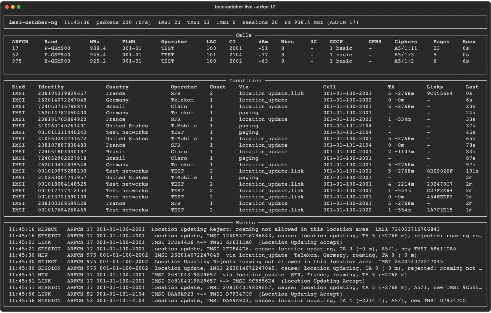

# imsi-catcher-ng

A passive, receive-only analyser for GSM (2G) radio signalling, written for
learning how mobile networks work. It reads the GSMTAP stream produced by
[gr-gsm](https://github.com/ptrkrysik/gr-gsm) (with an RTL-SDR or any other
osmosdr-supported receiver), decodes the broadcast and signalling messages a
base station sends, and shows what they reveal: the cell's configuration and
neighbours, paging, the identities phones present when they attach, the
ciphering algorithm in use, and more.



<sub>Screenshot generated from made-up traffic (test network 001-01, random identities) with `tools/render_screenshot.py`.</sub>

> [!WARNING]
> **Educational use only. Read the [disclaimer](#disclaimer) before using this software.**

## Credit

This project is inspired by [Oros42/IMSI-catcher](https://github.com/Oros42/IMSI-catcher).
Many thanks to its author and contributors for the original idea and for
showing how much a cheap SDR can teach about GSM. imsi-catcher-ng is a
from-scratch rewrite that keeps the same workflow (gr-gsm in front, a Python
analyser behind).

It also builds on [gr-gsm](https://github.com/ptrkrysik/gr-gsm), the
[Osmocom](https://osmocom.org/) GSMTAP format, [Wireshark](https://www.wireshark.org/)'s
GSM dissectors (used as the reference for testing) and Wikipedia's
[Mobile country code](https://en.wikipedia.org/wiki/Mobile_country_code) lists.

## Disclaimer

This software is published **for educational and research purposes only**: to
study how GSM networks signal, to test equipment and networks you own or are
explicitly authorized to assess, and to teach mobile security. It is passive:
it never transmits and cannot make a phone do anything. It does not decode
calls, SMS text or data.

Receiving, recording or processing radio transmissions and the identifiers of
other people is regulated or prohibited in many countries. **You alone are
responsible for making sure your use is lawful.** The author (Amit Schendel)
and contributors **accept no responsibility or liability for any misuse,
abuse, damage or legal consequence** arising from the use of this software.
It is provided "as is", without warranty of any kind (see [LICENSE](LICENSE)).

## What it decodes

* **System Information** (SI1, 2, 2bis, 2ter, 2quater, 3, 4, 13, 5, 6): cell
  identity (MCC, MNC, LAC, CI), GSM and UMTS neighbours, access rules,
  CCCH configuration, GPRS/EDGE support.
* **Paging** (types 1, 2 and 3): the TMSIs and IMSIs being paged.
* **Immediate Assignment** (and Extended / Reject): the assigned channel,
  the phone's timing advance (distance from the mast, in steps of about
  550 m) and why it asked for a channel.
* **Dedicated channels** (SDCCH and SACCH): the first message a phone sends
  is echoed by the network on the downlink, so the identity it presents in a
  Location Updating Request, Paging Response, CM Service Request or IMSI
  Detach is visible, followed by authentication, the Ciphering Mode Command
  (A5/x), location update accept or reject with its cause, TMSI reallocation
  and the network name and time.

Each SDCCH conversation is followed as a session. Two identities are linked
only when one session shows it, for example a Location Updating Accept that
assigns a new TMSI to the IMSI that asked.

## Requirements

* Linux with gr-gsm (Debian, Ubuntu, Raspberry Pi OS, Kali: `sudo apt install gr-gsm`)
* An SDR supported by gr-osmosdr. An RTL-SDR dongle covers GSM850 and
  GSM900; its tuner (R820T, R828D) stops around 1.75 GHz, so DCS1800 and
  PCS1900 need a receiver that tunes higher, such as a HackRF, LimeSDR,
  BladeRF or USRP
* Python 3.10 or newer

Tested on a Raspberry Pi 4 (Debian 13, gr-gsm 1.0.0) with an RTL-SDR.

## Install

```bash
git clone https://github.com/amitschendel/imsi-catcher-ng.git
cd imsi-catcher-ng
python3 -m venv .venv
.venv/bin/pip install -e ".[tui]"
```

## Usage

Find cells. `grgsm_scanner` is slow: on a Raspberry Pi 4 a band takes 20
minutes or more. A higher `--speed` (0 to 29, default 15) is faster but may
miss weak cells:

```bash
.venv/bin/imsi-catcher scan -b GSM900
.venv/bin/imsi-catcher scan -b GSM900 --speed 25
.venv/bin/imsi-catcher scan -b DCS1800 --device-args hackrf=0   # needs a receiver above 1.8 GHz
```

Watch a cell (this starts `grgsm_livemon_headless` for you):

```bash
.venv/bin/imsi-catcher live --arfcn 61
.venv/bin/imsi-catcher live --freq 947.2M --gain 35 --ppm 12
.venv/bin/imsi-catcher live --auto          # scan, then watch the strongest cell
```

Rotate one receiver over several cells, 60 seconds each:

```bash
.venv/bin/imsi-catcher hop 61 64 arfcn:118 --dwell 60
```

Use gr-gsm you run yourself, or a saved capture:

```bash
grgsm_livemon_headless --args rtl=0 -f 947.2M --collectorport 4729 --serverport 4800 &
.venv/bin/imsi-catcher listen --udp 4729
.venv/bin/imsi-catcher read capture.pcapng
```

Common options:

| Option | Meaning |
|---|---|
| `--ui tui\|plain` | live dashboard or one line per event |
| `--sqlite PATH` | events, identities and cells in SQLite |
| `--jsonl PATH` | every event as one JSON object per line (`-` for stdout) |
| `--csv PATH` | identity table snapshot |
| `--pcap PATH` | the raw GSMTAP stream, to open later in Wireshark |
| `--show-tmsi` | also list TMSIs in the console and dashboard |
| `--watch PREFIX` | alert when an identity starting with PREFIX is seen |
| `--device-args`, `-g`, `-p` | osmosdr device string (default `rtl=0`), gain, frequency correction |

`imsi-catcher db 425 01` looks up an MCC/MNC pair, and
`python3 tools/update_mcc_mnc.py` refreshes the bundled table.

## Where is the cell?

GSM does not broadcast the position of the base station, and phones do not
send their coordinates. To place a cell on a map, look its identity (MCC,
MNC, LAC and CI, shown in the Cells table, for example `001-01-100-2001`)
up in [OpenCellID](https://opencellid.org), a crowdsourced database of cell
towers:

* The API (`/cell/get?key=TOKEN&mcc=..&mnc=..&lac=..&cellid=..&format=json`)
  returns the estimated tower latitude and longitude, a coverage radius in
  metres and the number of measurements behind the estimate.
* The same data can be downloaded as CSV (per country, worldwide, or daily
  changes) from opencellid.org/downloads.php for offline use.
* Both need a free account and API token. The data is licensed CC BY-SA 4.0
  and requires attribution to OpenCellID.

Positions are estimated from where volunteers' phones saw the cell, so they
can be off by tens to hundreds of metres. The timing advance shown for a
phone only gives its distance from the tower in steps of about 550 m, with
no direction.

## Limitations

* GSM only; UMTS, LTE and 5G need other tools.
* One RTL-SDR covers one carrier. Dedicated channels on other carriers or
  with frequency hopping are reported but cannot be followed.
* Downlink only, and ciphered traffic is not decoded.
* `grgsm_livemon_headless` decodes timeslots 0 and 1 only.

## License

MIT, see [LICENSE](LICENSE). The bundled MCC/MNC data comes from Wikipedia
(CC BY-SA 4.0).
